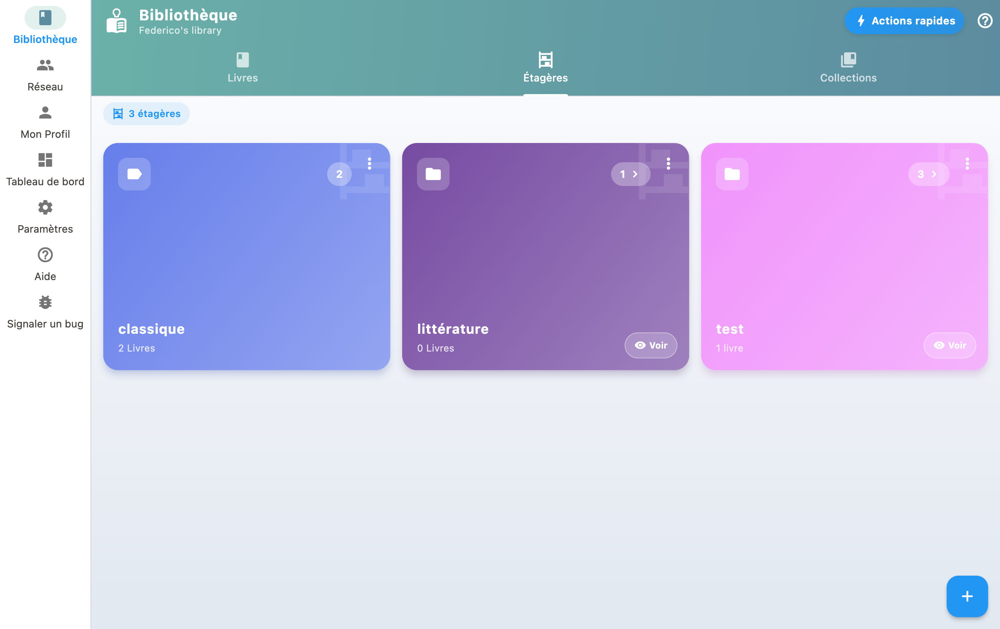

**Regal: wo Sie ein Buch einordnen.** Nach Thema, nach Raum, nach Genre. Ein Buch kann in mehreren Regalen stehen, und ein Regal kann weitere enthalten.

**Sammlung: eine Liste von Büchern, die zusammengehören, in einer Reihenfolge.** Die Bände einer Reihe, eine Auswahl zum Verleihen, Ihre Favoriten.

Zählt die Reihenfolge? Eine Sammlung. Sonst ein Regal.

## Regale anlegen und verwalten

1. Legen Sie Regale für Ihre Bücher an (etwa "Wohnzimmer", "Krimi").
2. Tippen Sie in Ihrer Bibliothek auf ein Regal, um zu filtern.
3. Tippen Sie auf „Regal neu ordnen“, um in den Umsortier-Modus zu wechseln.
4. Ziehen Sie die Bücher in die gewünschte Reihenfolge, oder tippen Sie auf A-Z, um automatisch nach Autor zu sortieren.
5. Tippen Sie auf die Bestätigung, um zu speichern: Das Regal folgt von nun an Ihrer Reihenfolge.

## Bücher Regalen zuordnen

Auf der Seite eines Buches ordnen Sie es einem oder mehreren Regalen zu. Dasselbe Buch darf in mehreren Regalen stehen.

## Reihenfolge ändern

In einem geöffneten Regal ordnet „Regal neu ordnen“ die Bücher per Ziehen neu an. Einmal gespeichert, ist diese Reihenfolge die des Regals: Sie bleibt erhalten, wenn Sie das Regal verlassen und wieder öffnen, und das Bearbeiten eines Buches hebt sie nicht auf. Ein Buch hat eine einzige Position: Steht es in zwei Regalen, verschiebt das Umsortieren des einen es auch im anderen. Das Sortiermenü bietet „Regalreihenfolge“ an, solange ein Regal geöffnet ist; überall sonst bleibt die Bibliothek nach Autor oder Titel sortiert.

## Die vorgeschlagenen Genres

Beim Hinzufügen oder Bearbeiten eines Buches schlägt BiblioGenius eine feste Liste von Genres vor (Krimi, Science-Fiction, Biografie, Comic und weitere), mit einer zweiten Ebene zum Verfeinern. Wählen Sie ein Genre, landet das Buch im passenden Regal.

Das ist eine Abkürzung, keine Pflicht: Das Regal entsteht erst in dem Moment, in dem Sie das Genre wählen, und Ihre eigenen Regale bleiben unberührt. Sie können die Vorschläge ignorieren und weiter alles von Hand einsortieren.
