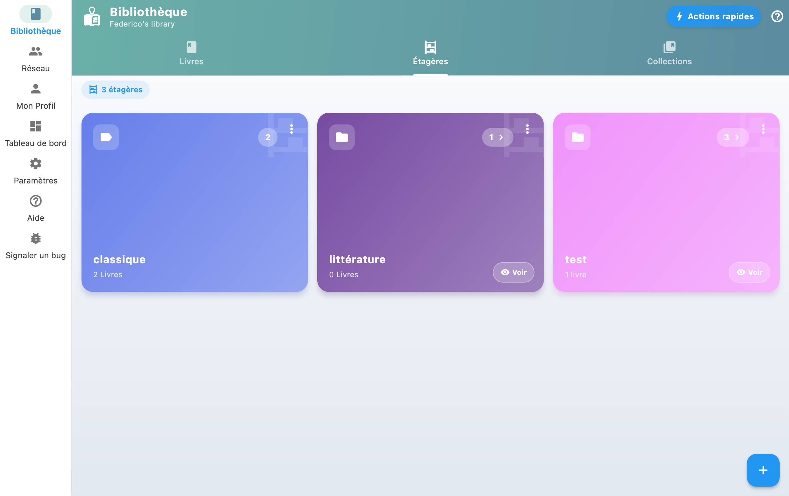

**Regal: wo Sie ein Buch einordnen.** Nach Thema, nach Raum, nach Genre. Ein Buch kann in mehreren Regalen stehen, und ein Regal kann weitere enthalten.

**Sammlung: eine Liste von Büchern, die zusammengehören, in einer Reihenfolge.** Die Bände einer Reihe, eine Auswahl zum Verleihen, Ihre Favoriten.

Zählt die Reihenfolge? Eine Sammlung. Sonst ein Regal.

## Der Reiter Regale

In Ihrer Bibliothek zeigt der Reiter **Regale** Ihre Regale als Karten, jede in ihrer eigenen Farbe und mit ihren neuesten Covern. Die angezeigte Zahl zählt ein Buch, das an mehreren Stellen steht, nur einmal, Unterregale eingeschlossen.

Die Schaltfläche **„Regal erstellen“** legt ein Regal auf der obersten Ebene an. Ein bereits vergebener Name wird abgelehnt, unabhängig von Groß- und Kleinschreibung.

## Jedes Regal hat seine Seite

Tippen Sie auf eine Karte, um das Regal zu betreten. Seine Seite zeigt zuerst die Unterregale als kleine Karten, dann die Bücher unter **„Hier eingeräumt“**.

Das Menü **„…“** der Seite bündelt, was dieses Regal betrifft: **Umbenennen**, **Unterregal hinzufügen**, **Verschieben nach…** und **Löschen**. Ein Regal kann weitere Regale enthalten, über mehrere Ebenen: „Romane“, darin „Krimis“, darin „Skandinavien“.

## Bücher ohne Regal einräumen

Oben im Reiter zählt die Karte **„Noch einzuräumen“** die Bücher, die in keinem Regal stehen, zum Beispiel nach dem Scannen eines ganzen Kartons. Tippen Sie darauf: Diese Bücher öffnen sich bereits im Auswahlmodus. Haken Sie sie an, oder **„Alle auswählen“**, dann **„Hinzufügen zu…“** und wählen Sie das Regal. Die Zahl sinkt, während Sie einräumen.

Die Karte verschwindet, sobald alles eingeräumt ist. Sie können sie auch ausblenden: Sie kommt zurück, wenn neue Bücher einzuräumen sind.

Derselbe Auswahlmodus funktioniert überall in der Bibliothek: Ein langes Drücken auf ein Buch öffnet ihn. Haken Sie **„Aus … entfernen“** für das ursprüngliche Regal an, und die Schaltfläche wird zu **„Verschieben“**.

## Bücher Regalen zuordnen

Auf der Seite eines Buches öffnet das Regalfeld beim Bearbeiten **„Regale wählen“**: Mehrere sind möglich, und zuletzt verwendete Regale stehen oben. Tippen Sie einen Namen ein, um ein Regal zu finden oder es direkt anzulegen, auf der obersten Ebene oder in einem anderen Regal.

## Ihre Regale neu ordnen

Die Schaltfläche **„Organisieren“** im Reiter öffnet den Bildschirm **„Regale organisieren“**: alle Ihre Regale als Baum. Ziehen Sie ein Regal auf ein anderes, um es darin einzuordnen (auf dem Smartphone mit langem Drücken). Das Menü **„…“** jedes Regals macht dasselbe per Tastatur oder Screenreader. Es erlaubt außerdem, das Regal zu bearbeiten, ein Unterregal hinzuzufügen, Bücher direkt hinein zu scannen oder es zu löschen.

Nichts ist sofort endgültig: Nach einem Verschieben oder Löschen bringt **„Rückgängig“** das Regal an seinen Platz zurück. Tippen Sie auf **„Fertig“**, um zu Ihren Regalen zurückzukehren.

## Die Reihenfolge der Bücher in einem Regal

Auf der Seite eines Regals ändert **„Regal neu ordnen“** die Reihenfolge der Bücher per Ziehen und Ablegen oder sortiert sie mit A-Z nach Autor. Einmal gespeichert, gilt diese Reihenfolge für das Regal: Sie bleibt, wenn Sie es verlassen und wieder öffnen, und das Bearbeiten eines Buches hebt sie nicht auf. Ein Buch hat nur eine Position: Steht es in zwei Regalen, verschiebt das Neuordnen des einen es auch im anderen.

## Die vorgeschlagenen Genres

Beim Hinzufügen oder Bearbeiten eines Buches schlägt BiblioGenius eine feste Liste von Genres vor (Krimi, Science-Fiction, Biografie, Comic und weitere), mit einer zweiten Ebene zum Verfeinern. Wählen Sie ein Genre, landet das Buch im passenden Regal.

Das ist eine Abkürzung, keine Pflicht: Das Regal entsteht erst in dem Moment, in dem Sie das Genre wählen, und Ihre eigenen Regale bleiben unberührt. Sie können die Vorschläge ignorieren und weiter alles von Hand einsortieren.
