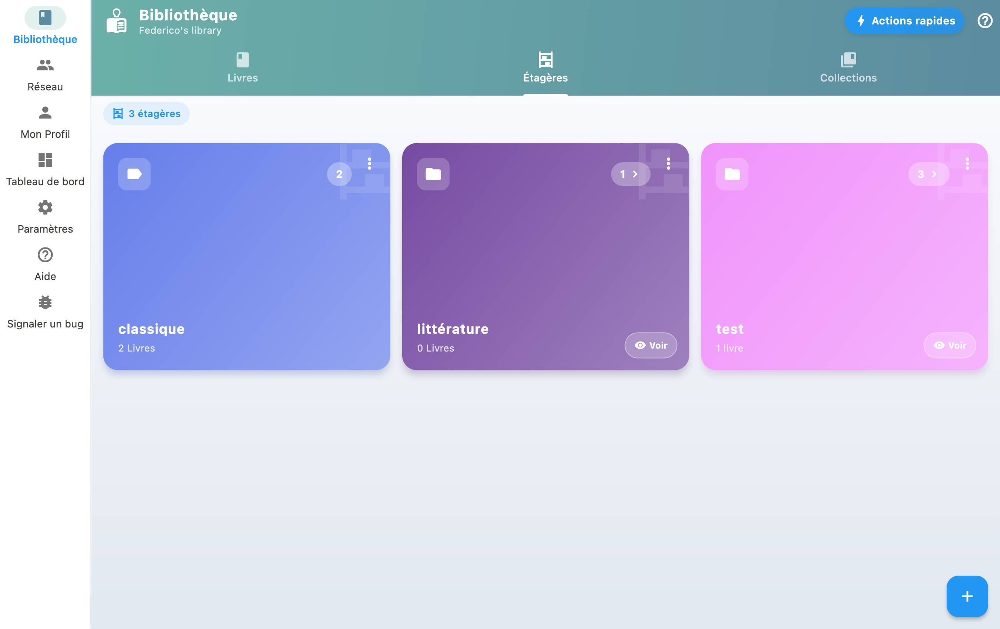

**Shelf: where you put a book.** By theme, by room, by genre. A book can sit on several shelves, and a shelf can hold other shelves.

**Collection: a list of books that belong together, in an order.** The volumes of a series, a selection to lend, your favorites. See [My collections](collections.html).

Does the order matter? A collection. Otherwise, a shelf.

## The Shelves tab

In your Library, the **Shelves** tab shows your shelves as cards, each in its own colour and illustrated with its most recent covers. The count shown counts a book filed in several places only once, sub-shelves included.

The **"Create Shelf"** button adds one at the first level. A name already taken is refused, whatever the capitals.

## Every shelf has its page

Tap a card to step into the shelf. Its page shows its sub-shelves first, as small cards, then the books **"Shelved here"**.

The page's **"…"** menu gathers what concerns this shelf: **Rename**, **Add Sub-Shelf**, **Move to…** and **Delete**. A shelf can hold other shelves, over several levels: "Novels", then "Crime" inside, then "Nordic".

## Shelving books that have no shelf

At the top of the tab, the **"To shelve"** card counts the books that are on no shelf, for instance after scanning a whole box. Tap it: those books open already in selection mode. Tick them, or **"Select all"**, then **"Add to…"** and pick the shelf. The count goes down as you shelve.

The card disappears once everything is shelved. You can also hide it: it comes back when new books need shelving.

The same selection mode works everywhere in the library: a long press on a book opens it. Tick **"Remove from"** the original shelf, and the button becomes **"Move"**.

## Assign books to shelves

From a book's page, when editing, the shelves field opens **"Choose shelves"**: several are possible, and recently used shelves come first. Type a name to find a shelf, or to create it on the spot, at the first level or inside another shelf.

## Rearranging your shelves

The tab's **"Organize"** button opens the **"Organize shelves"** screen: all your shelves as a tree. Drag a shelf onto another to file it inside (on a phone, with a long press). Each shelf's **"…"** menu does the same with a keyboard or a screen reader. It also lets you edit the shelf, add a sub-shelf to it, scan books straight into it or delete it.

Nothing is final on the spot: after a move or a deletion, **"Undo"** puts the shelf back where it was. Tap **"Done"** to return to your shelves.

## The order of books on a shelf

On a shelf's page, **"Reorder shelf"** changes the order of books by drag-and-drop, or sorts them by author with A-Z. Once saved, that order is the shelf's: it holds when you leave and reopen the shelf, and editing a book does not undo it. A book has a single position: if it sits on two shelves, reordering one moves it in the other too. The sort menu offers "Shelf order" while a shelf is open; elsewhere, the library stays sorted by author or by title.

## A shelf that looks empty

The count shown on a shelf matches what the shelf shows once opened: the two numbers no longer contradict each other.

A shelf whose books all sit outside the default view stays listed, at zero, and opens on an explanation: "Nothing on this shelf is in your library", with how many books are concerned, wishlist books or books on loan, and a **"Show them anyway"** button. See [My wishlist](wishlist.html).

## Suggested genres

When adding or editing a book, BiblioGenius offers a closed list of genres (crime, science fiction, biography, comics and so on), with a second level to refine. Picking a genre files the book on the matching shelf.

It is a shortcut, not an obligation: the shelf is only created when you pick the genre, and your own shelves are never touched. You can ignore the suggestions and keep filing everything by hand.
