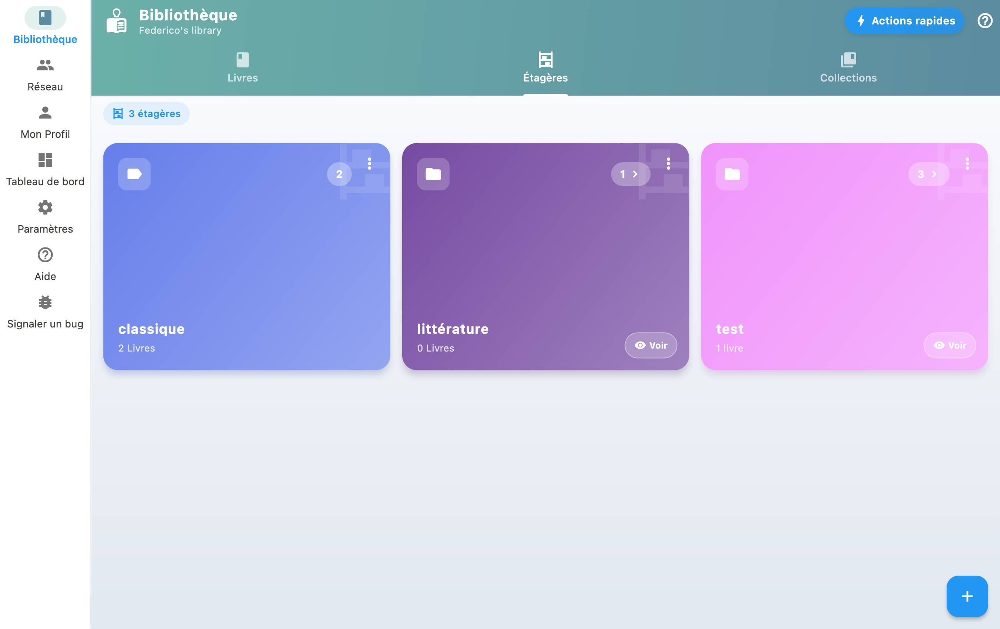

**Estantería: donde guardas un libro.** Por tema, por habitación, por género. Un libro puede estar en varias estanterías, y una estantería puede contener otras.

**Colección: una lista de libros que van juntos, en un orden.** Los tomos de una serie, una selección para prestar, tus favoritos.

¿Importa el orden? Una colección. Si no, una estantería.

## La pestaña Estanterías

En tu Biblioteca, la pestaña **Estanterías** muestra tus estanterías en tarjetas, cada una con su color e ilustrada con sus portadas más recientes. El número que se muestra cuenta una sola vez un libro colocado en varios sitios, sub-estanterías incluidas.

El botón **«Crear estantería»** añade una en el primer nivel. Un nombre ya usado se rechaza, sin tener en cuenta las mayúsculas.

## Cada estantería tiene su página

Toca una tarjeta para entrar en la estantería. Su página muestra primero sus sub-estanterías, en tarjetas pequeñas, y luego los libros **«Colocados aquí»**.

El menú **«…»** de la página reúne lo que concierne a esa estantería: **Renombrar**, **Añadir sub-estantería**, **Mover a…** y **Eliminar**. Una estantería puede contener otras, en varios niveles: «Novelas», luego «Policiacas» dentro, luego «Nórdicas».

## Colocar los libros que no tienen estantería

Arriba de la pestaña, la tarjeta **«Por colocar»** cuenta los libros que no están en ninguna estantería, por ejemplo después de escanear toda una caja. Tócala: esos libros se abren ya en modo selección. Márcalos, o **«Seleccionar todo»**, luego **«Añadir a…»** y elige la estantería. El número baja a medida que colocas.

La tarjeta desaparece cuando todo está colocado. También puedes ocultarla: vuelve cuando hay libros nuevos por colocar.

El mismo modo selección funciona en toda la biblioteca: una pulsación larga sobre un libro lo abre. Marca **«Quitar de»** la estantería de origen, y el botón pasa a **«Mover»**.

## Asignar libros a las estanterías

Desde la ficha de un libro, al editarla, el campo de estanterías abre **«Elegir estanterías»**: se pueden elegir varias, y las usadas recientemente aparecen primero. Escribe un nombre para buscar una estantería, o para crearla en el momento, en el primer nivel o dentro de otra estantería.

## Reorganizar tus estanterías

El botón **«Organizar»** de la pestaña abre la pantalla **«Organizar las estanterías»**: todas tus estanterías en árbol. Arrastra una estantería sobre otra para guardarla dentro (en el móvil, con una pulsación larga). El menú **«…»** de cada estantería hace lo mismo con el teclado o con un lector de pantalla. También permite editarla, añadirle una sub-estantería, escanear libros directamente en ella o eliminarla.

Nada es definitivo en el momento: tras un movimiento o una eliminación, **«Deshacer»** devuelve la estantería a su sitio. Toca **«Hecho»** para volver a tus estanterías.

## El orden de los libros en una estantería

En la página de una estantería, **«Reordenar estantería»** cambia el orden de los libros arrastrándolos, o los ordena por autor con A-Z. Una vez guardado, ese orden es el de la estantería: se mantiene cuando sales y vuelves a abrirla, y editar un libro no lo deshace. Un libro tiene una sola posición: si está en dos estanterías, reordenar una lo mueve también en la otra.

## Los géneros sugeridos

Al añadir o editar un libro, BiblioGenius propone una lista cerrada de géneros (novela negra, ciencia ficción, biografía, cómic y demás), con un segundo nivel para afinar. Elegir un género coloca el libro en la estantería correspondiente.

Es un atajo, no una obligación: la estantería solo se crea en el momento en que eliges el género, y tus propias estanterías nunca se tocan. Puedes ignorar las sugerencias y seguir clasificando todo a mano.
