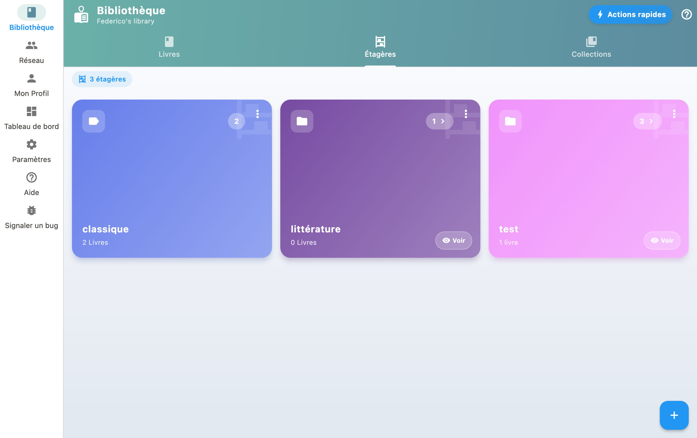

**Estantería: donde guardas un libro.** Por tema, por habitación, por género. Un libro puede estar en varias estanterías, y una estantería puede contener otras.

**Colección: una lista de libros que van juntos, en un orden.** Los tomos de una serie, una selección para prestar, tus favoritos.

¿Importa el orden? Una colección. Si no, una estantería.

## Crear y gestionar estanterías

1. Crea estanterías para tus libros (por ejemplo "Salón", "Novela negra").
2. En tu biblioteca, pulsa una estantería para filtrar.
3. Pulsa «Reordenar estantería» para entrar en modo reorganización.
4. Arrastra los libros hasta el orden que quieras, o pulsa A-Z para ordenarlos automáticamente por autor.
5. Pulsa el botón de validación para guardar: la estantería sigue desde ahora tu orden.

## Asignar libros a las estanterías

Desde la ficha de un libro puedes asignarlo a una o varias estanterías. Un mismo libro puede aparecer en varias.

## Cambiar el orden

En una estantería abierta, «Reordenar estantería» cambia el orden de los libros arrastrándolos. Una vez guardado, ese orden es el de la estantería: se mantiene al salir y volver a abrirla, y editar un libro no lo deshace. Un libro tiene una sola posición: si está en dos estanterías, reordenar una lo mueve también en la otra. El menú de orden ofrece «Orden de la estantería» mientras haya una estantería abierta; en el resto de la biblioteca, los libros siguen ordenados por autor o por título.

## Los géneros sugeridos

Al añadir o editar un libro, BiblioGenius propone una lista cerrada de géneros (novela negra, ciencia ficción, biografía, cómic y demás), con un segundo nivel para afinar. Elegir un género coloca el libro en la estantería correspondiente.

Es un atajo, no una obligación: la estantería solo se crea en el momento en que eliges el género, y tus propias estanterías nunca se tocan. Puedes ignorar las sugerencias y seguir clasificando todo a mano.
