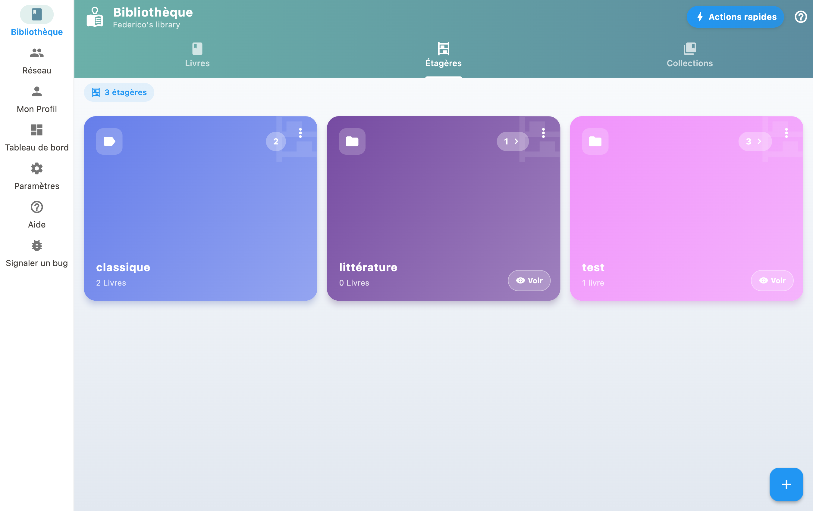

**Étagère : où vous rangez un livre.** Par thème, par pièce, par genre. Un livre peut être sur plusieurs étagères, et une étagère peut en contenir d'autres.

**Collection : une liste de livres qui vont ensemble, dans un ordre.** Les tomes d'une série, une sélection à prêter, vos favoris. Voir [Mes collections](collections.html).

L'ordre compte ? Une collection. Sinon, une étagère.

## Créer et gérer des étagères

1. Créez des étagères pour vos livres (ex : "Salon", "Polar").
2. Dans votre Bibliothèque, appuyez sur une étagère pour filtrer.
3. Appuyez sur « Réordonner l'étagère » pour entrer en mode réorganisation.
4. Faites glisser les livres dans l'ordre souhaité, ou appuyez sur A-Z pour un tri automatique par auteur.
5. Appuyez sur le bouton de validation pour enregistrer : l'étagère suit désormais votre ordre.

## Attribuer des livres aux étagères

Depuis la fiche d'un livre, vous pouvez l'assigner à une ou plusieurs étagères. Un même livre peut apparaître sur plusieurs étagères.

## Réorganiser l'ordre

Dans une étagère ouverte, « Réordonner l'étagère » change l'ordre des livres par glisser-déposer. Une fois enregistré, cet ordre est celui de l'étagère : il tient quand vous la quittez et la rouvrez, et la modification d'un livre ne le défait pas. Un livre n'a qu'une position : s'il est sur deux étagères, réordonner l'une le déplace aussi dans l'autre. Le menu de tri propose « Ordre de l'étagère » tant qu'une étagère est ouverte ; ailleurs, la bibliothèque reste triée par auteur ou par titre.

## Une étagère qui paraît vide

Le compte affiché sur une étagère correspond à ce que l'étagère montre une fois ouverte : les deux nombres ne se contredisent plus.

Une étagère dont tous les livres sont hors de la vue par défaut reste listée, à zéro, et s'ouvre sur une explication : « Rien de cette étagère n'est dans votre bibliothèque », avec le nombre de livres concernés, souhaits ou livres prêtés, et un bouton **« Les afficher quand même »**. Voir [Ma liste de souhaits](wishlist.html).

## Les genres suggérés

À l'ajout comme à la modification d'un livre, BiblioGenius propose une liste fermée de genres (roman policier, science-fiction, biographie, bande dessinée...), avec un second niveau pour préciser. Choisir un genre range le livre sur l'étagère correspondante.

C'est un raccourci, pas une obligation : l'étagère n'est créée qu'au moment où vous choisissez le genre, et vos propres étagères ne sont jamais modifiées. Vous pouvez ignorer les suggestions et continuer à classer entièrement à la main.
