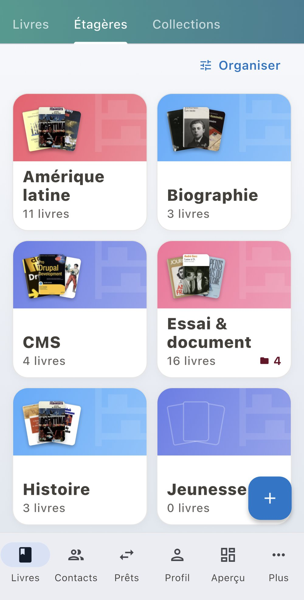

**Étagère : où vous rangez un livre.** Par thème, par pièce, par genre. Un livre peut être sur plusieurs étagères, et une étagère peut en contenir d'autres.

**Collection : une liste de livres qui vont ensemble, dans un ordre.** Les tomes d'une série, une sélection à prêter, vos favoris. Voir [Mes collections](collections.html).

L'ordre compte ? Une collection. Sinon, une étagère.

## L'onglet Étagères

Dans votre Bibliothèque, l'onglet **Étagères** présente vos étagères en cartes, chacune à sa couleur et illustrée par ses couvertures les plus récentes. Le nombre affiché compte une seule fois un livre rangé à plusieurs endroits, sous-étagères comprises.

Le bouton **+** (sur ordinateur, **« Créer une étagère »**) en ajoute une au premier niveau. Un nom déjà pris est refusé, sans tenir compte des majuscules.

## Chaque étagère a sa page

Touchez une carte pour entrer dans l'étagère. Sa page montre d'abord ses sous-étagères, en petites cartes, puis les livres **« Rangés ici »**.

Le menu **« … »** de la page regroupe ce qui concerne cette étagère : **Renommer**, **Ajouter une sous-étagère**, **Déplacer vers…** et **Supprimer**. Une étagère peut contenir d'autres étagères, sur plusieurs niveaux : « Romans », puis « Policiers » dedans, puis « Scandinaves ».

## Ranger les livres qui n'ont pas d'étagère

En tête de l'onglet, la carte **« À ranger »** compte les livres qui ne sont sur aucune étagère, par exemple après un scan de tout un carton. Touchez-la : ces livres s'ouvrent déjà en mode sélection. Cochez-les, ou **« Tout sélectionner »**, puis **« Ajouter à… »** et choisissez l'étagère. Le nombre baisse à mesure que vous rangez.

La carte disparaît quand tout est rangé. Vous pouvez aussi la masquer : elle revient quand de nouveaux livres sont à ranger.

Le même mode sélection marche partout dans la bibliothèque : un appui long sur un livre l'ouvre. Cochez **« Retirer de »** l'étagère d'origine, et le bouton devient **« Déplacer »**.

## Attribuer des livres aux étagères

Depuis la fiche d'un livre, en modification, le champ des étagères ouvre **« Choisir les étagères »** : plusieurs sont possibles, et les étagères utilisées récemment sont proposées en premier. Tapez un nom pour chercher une étagère, ou pour la créer sur place, au premier niveau ou dans une autre étagère.

## Réorganiser vos étagères

Le bouton **« Organiser »** de l'onglet ouvre l'écran **« Organiser les étagères »** : toutes vos étagères en arbre. Glissez une étagère sur une autre pour la ranger dedans (sur téléphone, avec un appui long). Le menu **« … »** de chaque étagère fait la même chose au clavier et avec un lecteur d'écran. Il permet aussi de modifier l'étagère, d'y ajouter une sous-étagère, d'y scanner des livres directement ou de la supprimer.

Rien n'est définitif sur le moment : après un déplacement ou une suppression, **« Annuler »** remet l'étagère où elle était. Touchez **« Terminé »** pour revenir à vos étagères.

## L'ordre des livres sur une étagère

Sur la page d'une étagère, **« Réordonner l'étagère »** change l'ordre des livres par glisser-déposer, ou les trie par auteur avec A-Z. Une fois enregistré, cet ordre est celui de l'étagère : il tient quand vous la quittez et la rouvrez, et la modification d'un livre ne le défait pas. Un livre n'a qu'une position : s'il est sur deux étagères, réordonner l'une le déplace aussi dans l'autre. Le menu de tri propose « Ordre de l'étagère » tant qu'une étagère est ouverte ; ailleurs, la bibliothèque reste triée par auteur ou par titre.

## Une étagère qui paraît vide

Le compte affiché sur une étagère correspond à ce que l'étagère montre une fois ouverte : les deux nombres ne se contredisent plus.

Une étagère dont tous les livres sont hors de la vue par défaut reste listée, à zéro, et s'ouvre sur une explication : « Rien de cette étagère n'est dans votre bibliothèque », avec le nombre de livres concernés, souhaits ou livres prêtés, et un bouton **« Les afficher quand même »**. Voir [Ma liste de souhaits](wishlist.html).

## Les genres suggérés

À l'ajout comme à la modification d'un livre, BiblioGenius propose une liste fermée de genres (roman policier, science-fiction, biographie, bande dessinée...), avec un second niveau pour préciser. Choisir un genre range le livre sur l'étagère correspondante ; un nouveau genre crée son étagère au premier niveau.

C'est un raccourci, pas une obligation : l'étagère n'est créée qu'au moment où vous choisissez le genre, et vos propres étagères ne sont jamais modifiées. Vous pouvez ignorer les suggestions et continuer à classer entièrement à la main.
