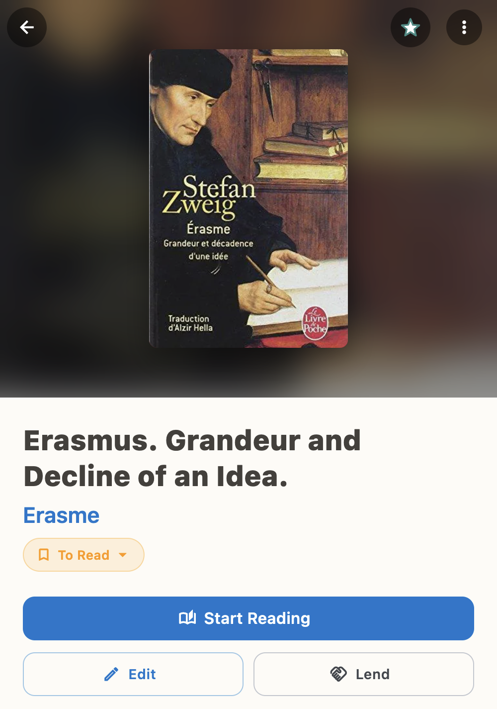
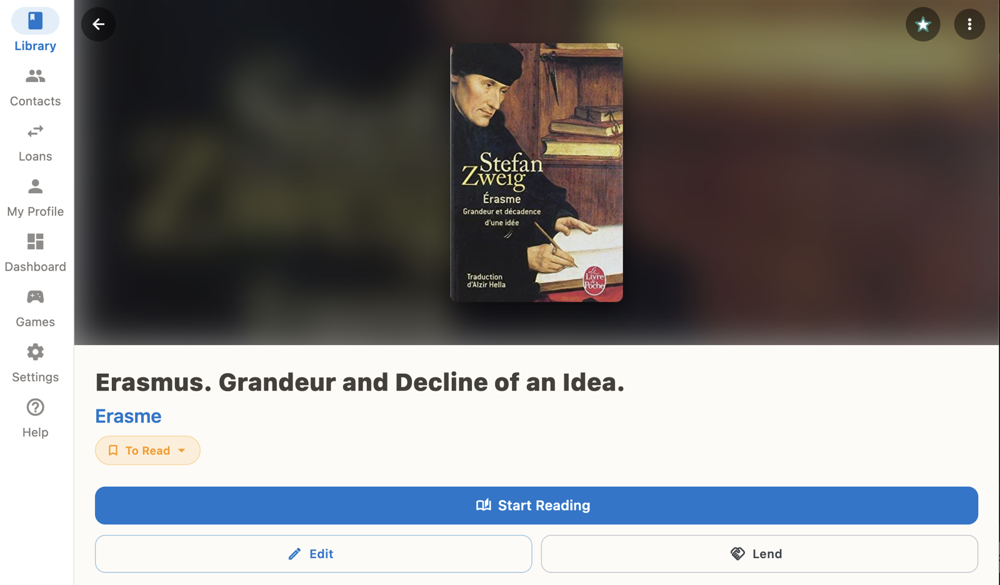
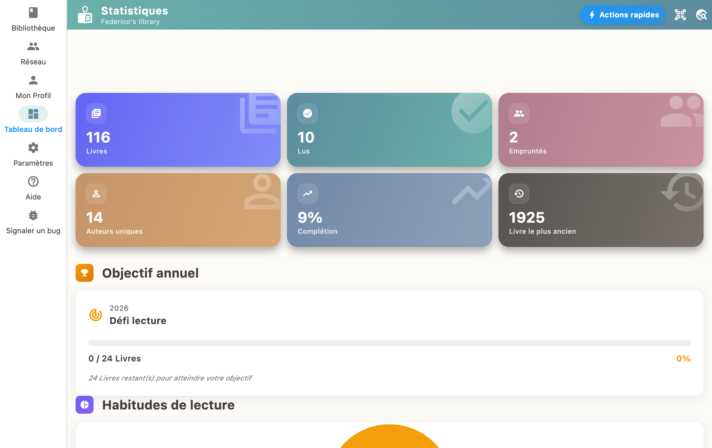

Es gibt immer ein Buch, das noch wartet, manchmal einen ganzen Stapel. BiblioGenius behält sie für Sie im Blick: Jedes Buch hat einen Lesestatus, **Zu lesen**, **Lese gerade**, **Gelesen** oder **Abgebrochen**, und Sie ändern ihn mit einem Fingertipp auf der Buchseite.

## Vier Status, vier Momente im Leben eines Buches

- **Zu lesen**: Es wartet auf Ihrem Stapel
- **Lese gerade**: Es liegt auf dem Nachttisch, das Lesezeichen steckt drin
- **Gelesen**: beendet, zugeklappt, bereit zum Verleihen
- **Abgebrochen**: beiseitegelegt, ohne Vorwurf und weiterhin im Blick

## Ihr Lesestapel, endlich gezählt

Im Dashboard (Reiter „Überblick“ auf dem Smartphone) zeigt der Abschnitt **Zu lesen**, wie viele Bücher auf Sie warten. **Alle zu lesen anzeigen** öffnet die ganze Liste. Die Bücher, die Sie gerade lesen, haben einen eigenen Abschnitt direkt darüber.

## Heute Abend fangen Sie eines an

1. Öffnen Sie die Buchseite.
2. Tippen Sie auf **Anfangen zu lesen**.
3. Geben Sie das Datum an, an dem Sie begonnen haben.

Das Buch wechselt zu „Lese gerade“ und verlässt den Stapel von selbst. Eines weniger.

## Die letzte Seite

Tippen Sie auf der Seite eines Buches, das Sie gerade lesen, auf **Als beendet markieren** und geben Sie das Enddatum an. Das Buch wechselt zu „Gelesen“.

## Jederzeit umentscheiden

Tippen Sie unter dem Buchtitel auf den angezeigten Status, zum Beispiel „Zu lesen“, und wählen Sie einen anderen aus der Liste. Hier markieren Sie ein Buch als „Abgebrochen“. Und wenn die Lust zurückkommt, geben Sie ihm hier auch eine zweite Chance und setzen es wieder auf „Lese gerade“.

## Ihre Lektüre in Zahlen

Der Bildschirm **Statistiken** zählt Ihre gelesenen Bücher und verfolgt Ihr Leseziel für das Jahr. So sehen Sie, wie der Stapel schrumpft und der Zähler steigt.

