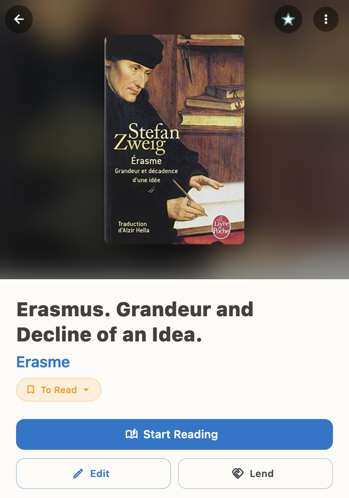
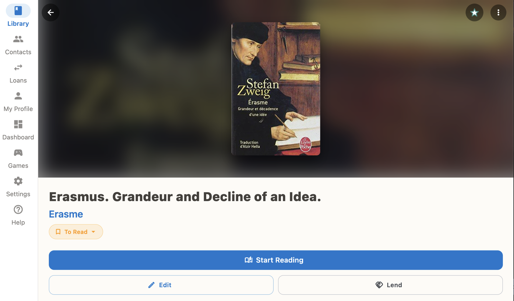
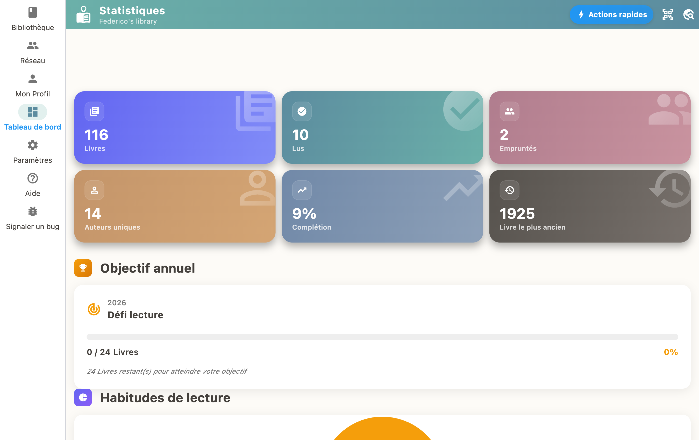

There is always a book waiting its turn, sometimes a whole pile. BiblioGenius keeps them in sight: every book has a reading status, **To Read**, **Reading**, **Read** or **Abandoned**, and you change it in one tap from the book's page.

## Four statuses, four moments in the life of a book

- **To Read**: it is waiting its turn on your pile
- **Reading**: it is on the bedside table, bookmark inside
- **Read**: finished, closed, ready to be lent
- **Abandoned**: set aside, no hard feelings, and still in sight

## Your to-read pile, counted at last

On the dashboard (the "Insights" tab on a phone), the **To Read** section shows how many books are waiting for you. **See all to read** opens the full list. The books you are reading have their own section, just above.

## Tonight, you start one

1. Open the book's page.
2. Tap **Start Reading**.
3. Enter the date you started it.

The book moves to "Reading" and leaves the pile on its own. One down.

## Last page turned

On the page of a book you are reading, tap **Mark as Finished** and enter the end date. The book moves to "Read".

## Change your mind, any time

Under the book's title, tap the status shown, for example "To Read", then pick another one from the list. This is where you mark a book as "Abandoned". And the day you feel like it again, this is also where you give it another chance by moving it back to "Reading".

## Your reading in numbers

The **Statistics** screen counts the books you have read and tracks your reading goal for the year. Enough to watch the pile go down and the counter go up.

