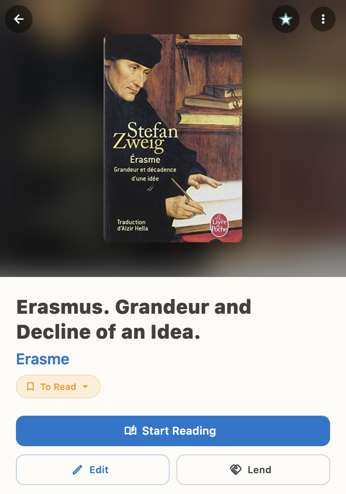
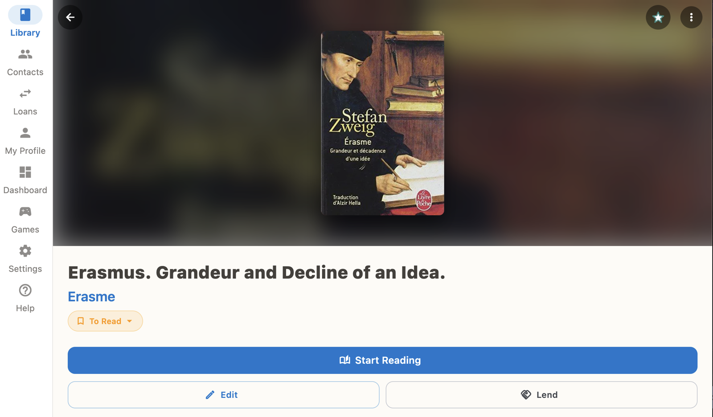
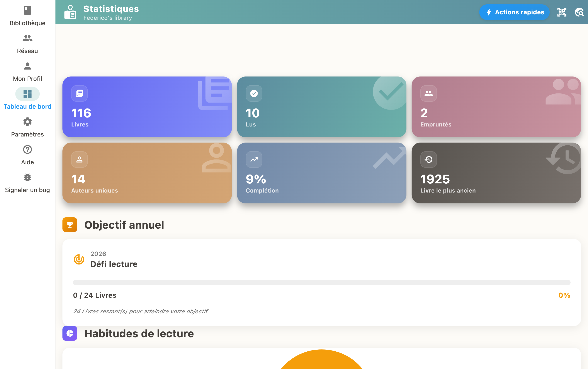

Siempre hay un libro esperando su turno, a veces toda una pila. BiblioGenius los mantiene a la vista: cada libro tiene un estado de lectura, **Por leer**, **Leyendo**, **Leído** o **Abandonado**, y lo cambias con un gesto desde su ficha.

## Cuatro estados, cuatro momentos en la vida de un libro

- **Por leer**: espera su turno en tu pila
- **Leyendo**: está en la mesilla de noche, con el marcapáginas dentro
- **Leído**: terminado, cerrado, listo para prestarlo
- **Abandonado**: apartado, sin reproches y sin perderlo de vista

## Tu pila por leer, por fin contada

En el panel de control (pestaña «Resumen» en el móvil), la sección **Por leer** muestra cuántos libros te esperan. **Ver todos por leer** abre la lista completa. Los libros que estás leyendo tienen su propia sección, justo encima.

## Esta noche empiezas uno

1. Abre la ficha del libro.
2. Pulsa **Empezar a leer**.
3. Indica la fecha en que lo empezaste.

El libro pasa a «Leyendo» y sale de la pila él solo. Uno menos.

## Última página

En la ficha de un libro que estás leyendo, pulsa **Marcar como terminado** e indica la fecha de fin. El libro pasa a «Leído».

## Cambiar de opinión, en cualquier momento

Debajo del título del libro, toca el estado que aparece, por ejemplo «Por leer», y elige otro en la lista. Aquí es donde marcas un libro como «Abandonado». Y el día que te vuelvan las ganas, aquí también le das otra oportunidad pasándolo de nuevo a «Leyendo».

## Tus lecturas en cifras

La pantalla **Estadísticas** cuenta los libros que has leído y sigue tu meta de lectura del año. Para ver cómo baja la pila y sube el contador.

