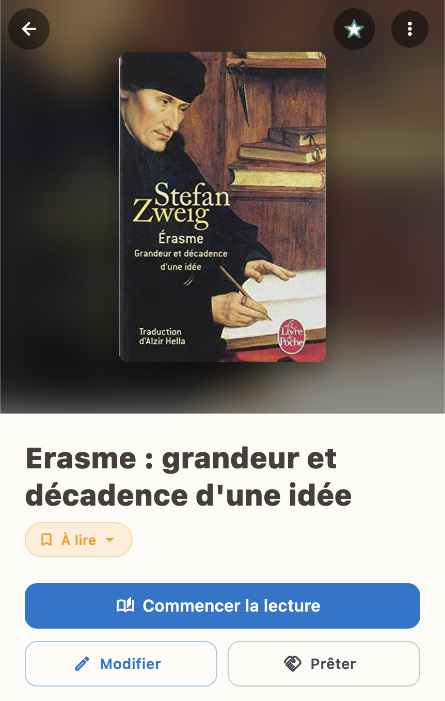
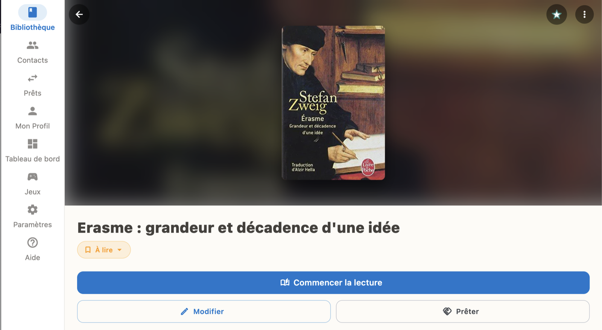
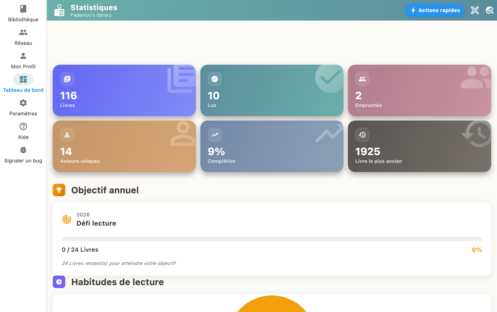

Il y a toujours un livre qui attend son tour, parfois toute une pile. BiblioGenius les garde sous vos yeux : chaque livre porte un statut de lecture, **À lire**, **En cours**, **Lu** ou **Abandonné**, et vous le changez d'un geste depuis sa fiche.

## Quatre statuts, quatre moments de la vie d'un livre

- **À lire** : il attend son tour sur votre pile
- **En cours** : il est sur la table de chevet, marque-page dedans
- **Lu** : terminé, refermé, prêt à être prêté
- **Abandonné** : laissé de côté, sans reproche et sans le perdre de vue

## Votre pile à lire, enfin comptée

Sur le tableau de bord (onglet « Aperçu » sur téléphone), la section **À lire** affiche le nombre de livres qui vous attendent, par exemple « À lire · 23 ». **Voir toute la pile à lire** l'ouvre en entier. Vos lectures en cours ont leur propre section, juste au-dessus.

## Ce soir, vous en commencez un

1. Ouvrez la fiche du livre.
2. Appuyez sur **Commencer la lecture**.
3. Indiquez la date à laquelle vous l'avez commencé.

Le livre passe en « En cours » et quitte la pile tout seul. Un de moins.

## Dernière page tournée

Sur la fiche d'un livre en cours, appuyez sur **Marquer comme terminé** et indiquez la date de fin. Le livre passe en « Lu ».

## Changer d'avis, à tout moment

Sous le titre du livre, touchez le statut affiché, par exemple « À lire », puis choisissez-en un autre dans la liste. C'est ici que vous notez un livre « Abandonné ». Et le jour où l'envie revient, c'est ici aussi que vous lui redonnez sa chance en le repassant « En cours ».

## Vos lectures en chiffres

L'écran **Statistiques** compte vos livres lus et suit votre objectif de lecture de l'année. De quoi voir la pile descendre et le compteur monter.

